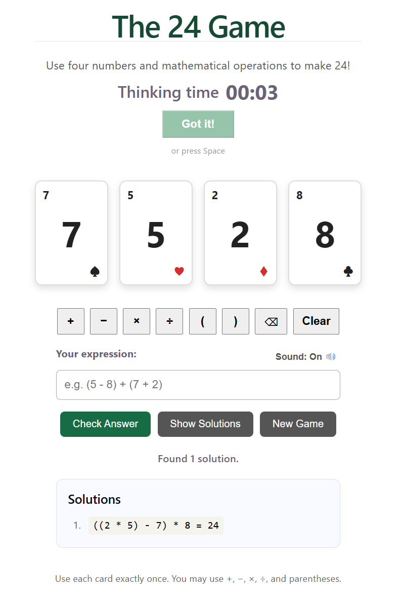

# 24 Game

A math puzzle game and software learning project, implemented using different programming languages and technology stacks.

The goal is to use all four number cards exactly once, combining them with addition, subtraction, multiplication, division, and parentheses to make 24.

## Live demo

[https://24-game-rose.vercel.app](https://24-game-rose.vercel.app)

## Screenshots



## Game Rules

- Each round deals four cards with values from 1 to 10.
- Use all four numbers exactly once.
- Use `+`, `-`, `×`, `÷`, and parentheses to form an expression.
- Every intermediate calculation must produce an integer. Fractions and decimals are not allowed.
- Generate new solvable hands and check your answer.
- View possible solutions when you need help.

## Timer and "Got it!" Button

The timer starts when a new game begins and counts up in `mm:ss`.

Typing an answer takes time and doesn't reflect how quickly a player worked it out. When you have the answer in your head, press **Got it!**. The timer stops and its label changes from "Time" to **Thinking time**. You can then type the expression at your own pace.

The timer also stops in these cases:

- **Correct answer:** the timer stops when a valid answer is checked. If Got it! was never pressed, this time includes typing, so the label stays "Time".
- **Show Solutions:** the timer stops when the solutions are shown. The label stays "Time", because a time recorded after seeing the answers is not a thinking time.

Starting a **New Game** resets the timer and the label.

## Keyboard Shortcuts

| Action | Shortcut |
|---|---|
| Got it! (stop the timer) | `Space` |
| Check Answer | `Alt+C` (or `Enter` while typing in the answer box) |
| Show Solutions | `Alt+S` |
| New Game | `Alt+N` |

The Got it! button has keyboard focus at the start of each game, so you can press `Space` right away. Once you click into the answer box, `Space` types a space as usual. The `Alt` shortcuts work from anywhere on the page.

## Implementations

| Version | Technologies | Status |
|---|---|---|
| TypeScript + React | React, TypeScript, Vite | [Live](https://24-game-rose.vercel.app) |
| Node.js + TypeScript | React, TypeScript, Node.js, Express | In development |
| WPF | C#, WPF | Planned |
| C# + ASP.NET Core | C#, ASP.NET Core Web API | Planned |
| Blazor | C#, Blazor | Planned |
| .NET MAUI | C#, .NET MAUI | Planned |

## React + TypeScript Version

The current implementation is located in [`react-typescript/`](react-typescript/frontend).

It includes:

- A React frontend built with TypeScript and Vite.
- Game logic for validating expressions and finding solutions.
- A solver that finds all unique solutions using integer-only intermediate calculations.
- Automatic generation of solvable hands using four copies of each card value from 1 to 10.
- Interactive number cards and direct expression input.
- Answer validation and a solution display.
- A timer with a "Got it!" button that records thinking time separately from typing time.
- Keyboard shortcuts for the main actions.
- An optional success sound.
- Automated unit tests using Vitest.

The frontend currently provides the playable game interface. Backend API development and frontend-backend integration are planned for future development.

## Project Goals

- Learn and practice different programming languages and frameworks.
- Compare different implementations of the same game.
- Practice software design, automated testing, and API development.
- Build portfolio projects that demonstrate practical software engineering skills.

## Technologies

- React
- TypeScript
- Vite
- Vitest

## Running the React + TypeScript Version

Open a terminal and navigate to the frontend directory:

```bash
cd react-typescript/frontend
```

Install dependencies:

```bash
npm install
```

Start the development server:

```bash
npm run dev
```

Run the tests:

```bash
npm test
```

Build the application:

```bash
npm run build
```

## Deployment

The React + TypeScript version is deployed on [Vercel](https://vercel.com) at https://24-game-rose.vercel.app. Vercel deploys automatically each time changes are pushed to the `main` branch.

Deployment settings:

- **Root directory:** `react-typescript/frontend`
- **Framework preset:** Vite
- **Build command:** `npm run build`
- **Output directory:** `dist`

## License

This project is licensed under the MIT License. See the [LICENSE](LICENSE) file for details.
