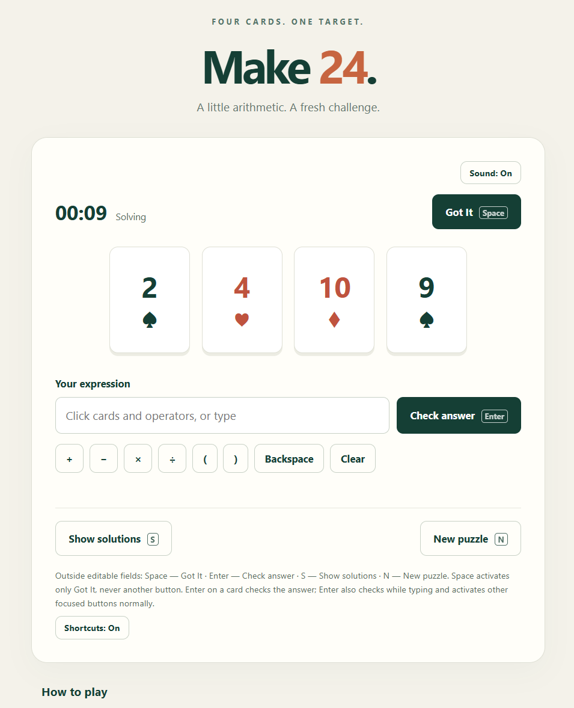
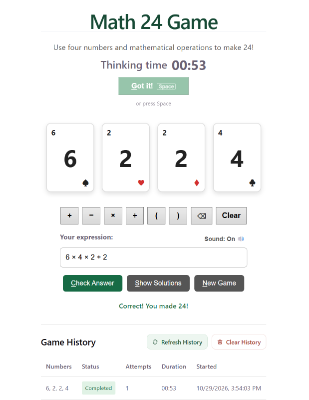

# 24 Game

A math puzzle game and software learning project, implemented using different programming languages and technology stacks.

The goal is to use all four number cards exactly once, combining them with addition, subtraction, multiplication, division, and parentheses to make 24.

## Live Demos

- [React + TypeScript Version](https://24-game-rose.vercel.app)
- [Codex React + TypeScript Experiment](https://24-game-codex.vercel.app)
- [Node.js Full-Stack Version](https://24-game-fullstack.vercel.app)

## Screenshots

### React + TypeScript Version


### Codex Experiment



### Node.js + Prisma + PostgreSQL Full-stack Version



## Game Rules

- Each round deals four cards with values from 1 to 10.
- Use all four numbers exactly once.
- Use `+`, `-`, `×`, `÷`, and parentheses to form an expression.
- Every intermediate calculation must produce an integer. Fractions and decimals are not allowed.
- Generate new solvable hands and check your answer.
- View possible solutions when you need help.

## Timer and "Got It!" Button

The timer starts when a new game begins and counts up in `mm:ss`.

Typing an answer takes time and doesn't reflect how quickly a player worked it out. When you have the answer in your head, press **Got it!**. The timer stops and its label changes from "Time" to **Thinking time**. You can then type the expression at your own pace.

The timer also stops in these cases:

- **Correct answer:** The timer stops when a valid answer is checked. If Got it! was never pressed, the recorded time includes typing, so the label stays "Time".
- **Show Solutions:** The timer stops when the solutions are shown. The label stays "Time", because a time recorded after seeing the answers is not a thinking time.

Starting a **New Game** resets the timer and its label.

## Keyboard Shortcuts

Keyboard shortcuts vary by implementation.

In the original React + TypeScript version:

| Action | Shortcut |
|---|---|
| Got it! (stop the timer) | `Space` |
| Check Answer | `Alt+C` or `Enter` in the answer box |
| Show Solutions | `Alt+S` |
| New Game | `Alt+N` |

The full-stack version also supports keyboard shortcuts for the main game actions. Refer to the implementation's UI for its current shortcuts.

## Implementations

| Version | Technologies | Status |
|---|---|---|
| React + TypeScript | React, TypeScript, Vite | Live |
| Codex React + TypeScript Experiment | React, TypeScript, Vite | Live |
| Node.js Full-Stack | React, TypeScript, Vite, Node.js, Express, Prisma, PostgreSQL | Live; production database initialized |
| WPF | C#, WPF | Planned |
| C# + ASP.NET Core | C#, ASP.NET Core Web API | Planned |
| Angular | Angular, TypeScript | Planned |
| .NET MAUI | C#, .NET MAUI | Planned |

## React + TypeScript Version

The original implementation is located in [`react-typescript/frontend/`](react-typescript/frontend).

It includes:

- A React frontend built with TypeScript and Vite.
- Game logic for validating expressions and finding solutions.
- A solver that finds unique solutions using integer-only intermediate calculations.
- Automatic generation of solvable hands using four copies of each card value from 1 to 10.
- Interactive number cards and direct expression input.
- Answer validation and a solution display.
- A timer with a "Got it!" button that records thinking time separately from typing time.
- Keyboard shortcuts for the main actions.
- An optional success sound.
- Automated unit tests using Vitest.

This version runs independently in the browser and does not require the Node.js backend.

## Codex React + TypeScript Experiment

This implementation was created with OpenAI Codex as an experiment in AI-assisted software development.

- Built with React, TypeScript, and Vite.
- Includes automated tests for game logic, input handling, timer behavior, and UI interactions.
- Uses integer-only intermediate calculations.
- Deployed separately on Vercel.

**Live demo:** [24-game-codex.vercel.app](https://24-game-codex.vercel.app)

Source code: [`codex-experiment/`](codex-experiment/)

## Node.js Full-Stack Version

Located in [`nodejs-fullstack/`](nodejs-fullstack/), this implementation extends the game into a full-stack web application.

### Technology Stack

- **Frontend:** React, TypeScript, Vite
- **Backend:** Node.js, Express, TypeScript
- **Database:** PostgreSQL
- **ORM and migrations:** Prisma 7
- **Deployment:** Vercel

### Architecture

The frontend communicates with the Express REST API. The backend implements game operations and uses Prisma to access PostgreSQL for persistent game data.

The application includes API endpoints for puzzle generation and game operations, along with a game history interface.

### Database

PostgreSQL stores game-related data, including games, game sessions, and attempts.

Prisma migrations manage database schema changes. The migration files are maintained in the repository under `nodejs-fullstack/backend/prisma/migrations/`.

For local development, configure the backend environment variables using the provided `.env.example` file. Set up a PostgreSQL database and apply the existing migrations before running database-backed features.

The six existing migrations were applied to the production database on October 29, 2026. Prisma confirmed that its migration history was up to date. The database includes `Game`, `GameSession`, `GameAttempt`, and Prisma's `_prisma_migrations` table.

### Deployment

The full-stack version is deployed on Vercel as separate frontend and backend projects.

- **Frontend:** [24-game-fullstack.vercel.app](https://24-game-fullstack.vercel.app)
- **Backend:** [24-game-nodejs-api.vercel.app](https://24-game-nodejs-api.vercel.app)

The frontend uses `VITE_API_BASE_URL` to identify the backend API. The backend uses environment variables to configure its database connection and other runtime settings.

Database migrations must be applied to the intended production database before database-backed features can operate correctly.

Generating Prisma Client or running an ordinary `vercel deploy` does not currently apply migrations. See the [full-stack deployment and migration instructions](nodejs-fullstack/README.md#vercel-deployment-and-production-migrations) for the separate workflow, including protected production credentials.

## Project Goals

- Learn and practice different programming languages and frameworks.
- Compare different implementations of the same game.
- Practice software design, automated testing, API development, and database integration.
- Build portfolio projects that demonstrate practical software engineering skills.
- Explore AI-assisted software development while maintaining working, independently deployable implementations.

## Technologies

- React
- TypeScript
- Vite
- Vitest
- Node.js
- Express
- PostgreSQL
- Prisma
- C#
- .NET

## Running the React + TypeScript Version

Open a terminal and navigate to the frontend directory:

```bash
cd react-typescript/frontend
```

Install dependencies:

```bash
npm ci
```

Start the development server:

```bash
npm run dev
```

Run the tests:

```bash
npm test
```

Build the application:

```bash
npm run build
```

## Running the Node.js Full-Stack Version

The frontend and backend are separate applications and must be configured independently.

### Backend

Navigate to the backend directory:

```bash
cd nodejs-fullstack/backend
```

Install dependencies:

```bash
npm ci
```

Configure the environment variables and PostgreSQL connection using `.env.example`. Ensure that `DATABASE_URL` points to the intended database for Prisma migrations.

Use a development database for verification. If `DATABASE_URL_POOLED` is set, the application prefers it at runtime; it must point to the same database and schema as `DATABASE_URL`.

Apply the existing migrations:

For a populated database that predates game sessions, first follow the [legacy upgrade instructions](nodejs-fullstack/README.md#upgrading-existing-games-to-sessions).

```bash
npx prisma migrate deploy --config prisma7.config.ts
```

Generate the Prisma client and run the backend verification suite:

```bash
npm run db:generate
npm run verify
```

Start the backend development server using the project's configured development script:

```bash
npm run dev
```

### Frontend

In a separate terminal, navigate to the frontend directory:

```bash
cd nodejs-fullstack/frontend
```

Install dependencies:

```bash
npm ci
```

Copy the frontend `.env.example` to `.env` if no local configuration exists. Leave `VITE_API_BASE_URL` empty to use Vite's local proxy to `http://localhost:3000`, or set it to the backend origin. Then start the frontend:

```bash
npm run dev
```

See the [full-stack README](nodejs-fullstack/README.md) for quick setup, environment variables, API documentation, and verification commands.

## Deployment

The original React + TypeScript version is deployed on [Vercel](https://vercel.com/):

- **Live URL:** [24-game-rose.vercel.app](https://24-game-rose.vercel.app)
- **Root directory:** `react-typescript/frontend`
- **Framework preset:** Vite
- **Build command:** `npm run build`
- **Output directory:** `dist`

Vercel deploys automatically when changes are pushed to the configured production branch.

The Codex experiment is deployed as a separate Vercel project:

- **Live URL:** [24-game-codex.vercel.app](https://24-game-codex.vercel.app)
- **Root directory:** `codex-experiment`

The full-stack version uses separate Vercel projects for the frontend and backend. Configure each project with its corresponding root directory, build settings, and environment variables. Database migrations are a separate deployment responsibility and must be applied to the intended production database.

- **Live URL:** [24-game-fullstack.vercel.app](https://24-game-fullstack.vercel.app)
- **Backend URL:** [24-game-nodejs-api.vercel.app](https://24-game-nodejs-api.vercel.app)
- **Backend Root directory:** `nodejs-fullstack/backend`
- **Frontend Root directory:** `nodejs-fullstack/frontend`

## License

This project is licensed under the MIT License. See the [LICENSE](LICENSE) file for details.
