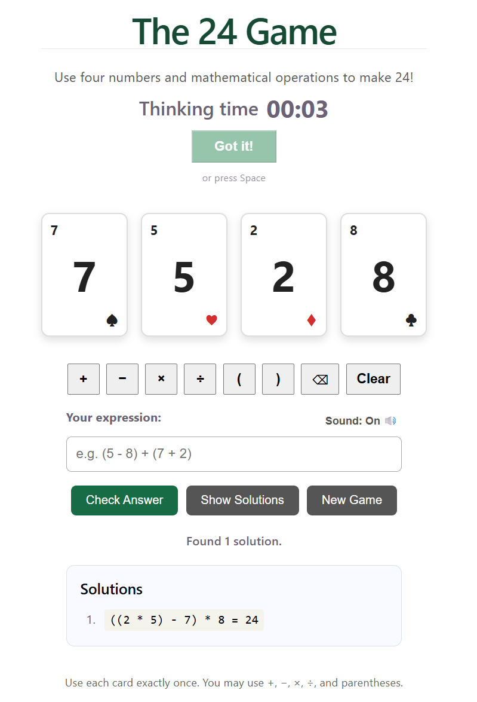
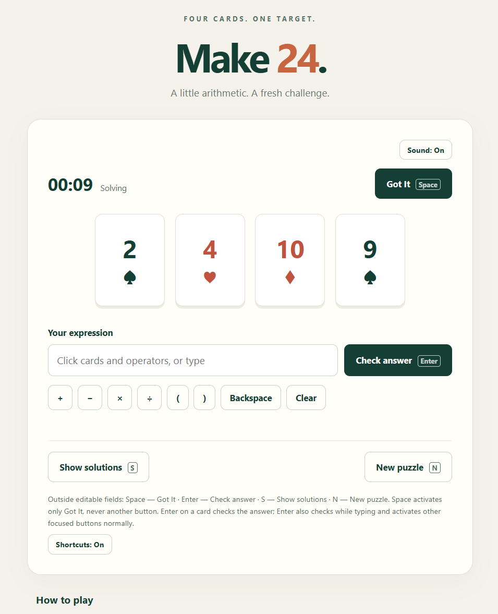
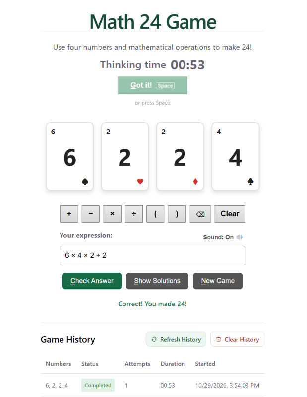
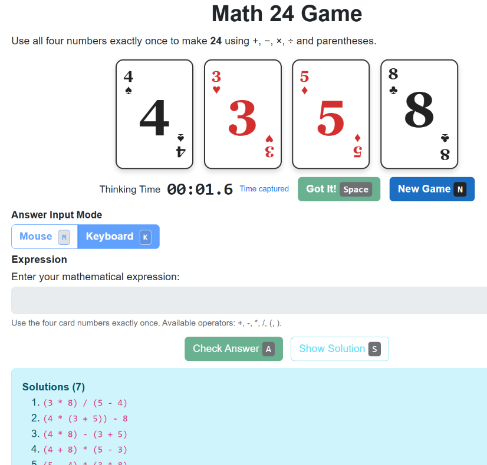

# 24 Game

A math puzzle game and software learning project, implemented using different programming languages and technology stacks.

The goal is to use all four number cards exactly once, combining them with addition, subtraction, multiplication, division, and parentheses to make 24.

## Live Demos

- [React + TypeScript Version](https://24-game-rose.vercel.app)
- [Codex React + TypeScript Experiment](https://24-game-codex.vercel.app)
- [Node.js Full-Stack Version](https://24-game-fullstack.vercel.app)
- [.NET — Blazor WebAssembly on Vercel](https://blazor-wasm-beige.vercel.app)
- [.NET — Blazor Interactive Server on Azure](https://twentyfourgame-web-adc8daghhthxb8ab.canadaeast-01.azurewebsites.net/)

## Screenshots

### React + TypeScript Version



### Codex Experiment



### Node.js + Prisma + PostgreSQL Full-stack Version



### .NET Full-Stack Version (Blazor Interactive Server + ASP.NET Core)



## Game Rules

- Each round deals four cards with values from 1 to 10.
- Use all four numbers exactly once.
- Use `+`, `-`, `×`, `÷`, and parentheses to form an expression.
- Every intermediate calculation must produce an integer. Fractions and decimals are not allowed.
- Generate new solvable hands and check your answer.
- View possible solutions when you need help.

## Timer and "Got It!" Button

In the original React + TypeScript version, the timer starts when a new game begins and counts up in `mm:ss`.

Typing an answer takes time and doesn't reflect how quickly a player worked it out. When you have the answer in your head, press **Got it!**. The timer stops and its label changes from "Time" to **Thinking time**. You can then type the expression at your own pace.

The timer also stops in these cases:

- **Correct answer:** The timer stops when a valid answer is checked. If Got it! was never pressed, the recorded time includes typing, so the label stays "Time".
- **Show Solutions:** The timer stops when the solutions are shown. The label stays "Time", because a time recorded after seeing the answers is not a thinking time.

Starting a **New Game** resets the timer and its label.

The .NET frontends display elapsed time in `mm:ss.t`. **Got It!** captures the elapsed time through the API, and refreshing the page restores the active puzzle and its timer state. See the [.NET documentation](dotnet-fullstack/README.md) for the Blazor behavior and session restoration details.

## Keyboard Shortcuts

Keyboard shortcuts vary by implementation.

In the original React + TypeScript version:

| Action | Shortcut |
|---|---|
| Got it! (stop the timer) | `Space` |
| Check Answer | `Alt+C` or `Enter` in the answer box |
| Show Solutions | `Alt+S` |
| New Game | `Alt+N` |

The Node.js full-stack version also supports keyboard shortcuts for the main game actions. Refer to the implementation's UI for its current shortcuts.

Both .NET frontends support mouse input and keyboard shortcuts. See the [Blazor keyboard shortcuts](dotnet-fullstack/README.md#keyboard-shortcuts) for the complete mapping.

## Implementations

| Version | Technologies | Status |
|---|---|---|
| React + TypeScript | React, TypeScript, Vite | Live |
| Codex React + TypeScript Experiment | React, TypeScript, Vite | Live |
| Node.js Full-Stack | React, TypeScript, Vite, Node.js, Express, Prisma, PostgreSQL | Live |
| .NET Full-Stack | C#, .NET 10, Blazor WebAssembly and Interactive Server, ASP.NET Core Web API, EF Core 10, PostgreSQL | Live |
| Angular | Java, PostgreSQL | Planned |
| .NET MAUI | C#, .NET MAUI | Planned |
| WPF | C#, WPF | Planned |

## React + TypeScript Version

The original implementation is located in [`react-typescript/frontend/`](react-typescript/frontend).

It includes:

- A React frontend built with TypeScript and Vite.
- Game logic for validating expressions and finding solutions.
- A solver that finds unique solutions using integer-only intermediate calculations.
- Automatic generation of solvable hands using four copies of each card value from 1 to 10.
- Interactive number cards and direct expression input.
- Answer validation and a solution display.
- A timer with a "Got it!" button that records thinking time separately from typing time.
- Keyboard shortcuts for the main actions.
- An optional success sound.
- Automated unit tests using Vitest.

This version runs independently in the browser and does not require the Node.js backend.

## Codex React + TypeScript Experiment

This implementation was created with OpenAI Codex as an experiment in AI-assisted software development.

- Built with React, TypeScript, and Vite.
- Includes automated tests for game logic, input handling, timer behavior, and UI interactions.
- Uses integer-only intermediate calculations.
- Deployed separately on Vercel.

**Live demo:** [24-game-codex.vercel.app](https://24-game-codex.vercel.app)

Source code: [`codex-experiment/`](codex-experiment/)

## Node.js Full-Stack Version

Located in [`nodejs-fullstack/`](nodejs-fullstack/), this implementation extends the game into a full-stack web application.

### Technology Stack

- **Frontend:** React, TypeScript, Vite
- **Backend:** Node.js, Express, TypeScript
- **Database:** PostgreSQL
- **ORM and migrations:** Prisma 7
- **Deployment:** Vercel

### Architecture

The frontend communicates with the Express REST API. The backend implements game operations and uses Prisma to access PostgreSQL for persistent game data.

The application includes API endpoints for puzzle generation and game operations, along with a game history interface.

### Database

PostgreSQL stores game-related data, including games, game sessions, and attempts.

Prisma migrations manage database schema changes. The migration files are maintained in the repository under `nodejs-fullstack/backend/prisma/migrations/`.

For local development, configure the backend environment variables using the provided `.env.example` file. Set up a PostgreSQL database and apply the existing migrations before running database-backed features.

The six existing migrations were applied to the production database on October 29, 2026. Prisma confirmed that its migration history was up to date. The database includes `Game`, `GameSession`, `GameAttempt`, and Prisma's `_prisma_migrations` table.

### Deployment

The full-stack version is deployed on Vercel as separate frontend and backend projects.

- **Frontend:** [24-game-fullstack.vercel.app](https://24-game-fullstack.vercel.app)
- **Backend:** [24-game-nodejs-api.vercel.app](https://24-game-nodejs-api.vercel.app)

The frontend uses `VITE_API_BASE_URL` to identify the backend API. The backend uses environment variables to configure its database connection and other runtime settings.

Database migrations must be applied to the intended production database before database-backed features can operate correctly.

Generating Prisma Client or running an ordinary `vercel deploy` does not currently apply migrations. See the [full-stack deployment and migration instructions](nodejs-fullstack/README.md#vercel-deployment-and-production-migrations) for the separate workflow, including protected production credentials.

## .NET Full-Stack Version

Located in [`dotnet-fullstack/`](dotnet-fullstack/), this independent implementation provides two **.NET 10 Blazor frontends** that use the same layered **ASP.NET Core 10 REST API** and **Neon PostgreSQL** database through **Entity Framework Core 10**.

| Frontend | Source | Hosting and live demo |
|---|---|---|
| Standalone Blazor WebAssembly | [`blazor-wasm/`](dotnet-fullstack/blazor-wasm/) | [Vercel](https://blazor-wasm-beige.vercel.app) |
| Blazor Interactive Server | [`blazor-frontend/`](dotnet-fullstack/blazor-frontend/) | [Azure App Service](https://twentyfourgame-web-adc8daghhthxb8ab.canadaeast-01.azurewebsites.net/) |

The existing Interactive Server application remains available as a separate application. The WebAssembly frontend reuses its game components, CSS, API client, and browser storage helpers in a separate project.

### Architecture and features

- **Gameplay:** Both frontends provide interactive number cards, mouse and keyboard expression input, a timer, **Got It!**, answer submission, and solution display.
- **Backend:** ASP.NET Core REST API organized into API, Application, Domain, and Infrastructure layers.
- **Persistence:** PostgreSQL stores game sessions, games, attempts, and timing information; EF Core manages the schema through migrations.
- **Session restoration:** The browser remembers the session ID and input mode; the frontend retrieves the active puzzle and timing state from the API after a refresh.
- **History and statistics API:** REST endpoints provide game history and session statistics.
- **Health endpoints:** `/health` checks application availability; `/health/db` checks database connectivity.

### Production deployment

Vercel serves the WebAssembly frontend's static files. Its game UI runs in the browser and sends HTTPS REST requests directly to the Azure API. The Interactive Server frontend runs in its existing Linux .NET 10 Azure App Service, uses a Blazor SignalR connection with the browser, and calls the same API from the server. The API runs in a separate Linux .NET 10 Azure App Service and accesses PostgreSQL on Neon.

Browser API requests from WebAssembly require CORS. The API's Azure App Service CORS allowed-origin list permits the Vercel frontend and the local WebAssembly development origin. See the [.NET configuration and deployment documentation](dotnet-fullstack/README.md) for the exact settings.

Three GitHub Actions workflows automate building and deployment:

| Workflow | Automatic trigger | Deployment |
|---|---|---|
| [Blazor WASM CI/CD](.github/workflows/blazor-wasm-ci.yml) | Push to `main` changing `dotnet-fullstack/blazor-wasm/**` or the workflow file | Publishes .NET 10 WebAssembly, validates the static output, and deploys the prepared files to Vercel production |
| [Interactive Server CI/CD](.github/workflows/frontend-ci.yml) | Push to `main` changing `dotnet-fullstack/blazor-frontend/**` or the workflow file | Builds and publishes the existing frontend to Azure |
| [Backend CI/CD](.github/workflows/backend-ci.yml) | Every push to `main` | Builds and publishes the API, generates an EF Core migration SQL artifact, and deploys to Azure |

All three workflows also support manual dispatch. The WebAssembly production job is restricted to `main`.

The Azure workflows authenticate using Microsoft Entra ID **OpenID Connect (OIDC)**. The Vercel workflow uses the repository secrets `VERCEL_TOKEN`, `VERCEL_ORG_ID`, and `VERCEL_PROJECT_ID` to deploy to the existing `blazor-wasm` project. Its first automated deployment has completed successfully.

Database credentials remain in the backend's Azure App Service configuration. The Interactive Server API URL is also configured in Azure; the WebAssembly API URL is public browser configuration in `wwwroot/appsettings.json`. EF Core migrations are reviewed and applied separately: generating the SQL artifact does not execute it against the database.

For local setup, architecture details, API endpoints, testing, configuration, and deployment notes, see the **[.NET full-stack README](dotnet-fullstack/README.md)**.

## Project Goals

- Learn and practice different programming languages and frameworks.
- Compare different implementations of the same game.
- Practice software design, automated testing, API development, and database integration.
- Build portfolio projects that demonstrate practical software engineering skills.
- Explore AI-assisted software development while maintaining working, independently deployable implementations.

## Technologies

- React
- TypeScript
- Vite
- Vitest
- Node.js
- Express
- PostgreSQL
- Prisma
- C#
- .NET 10
- Blazor WebAssembly
- Blazor Interactive Server
- ASP.NET Core
- Entity Framework Core
- Azure App Service
- Vercel
- Neon
- GitHub Actions

## Running the React + TypeScript Version

Open a terminal and navigate to the frontend directory:

```bash
cd react-typescript/frontend
```

Install dependencies:

```bash
npm ci
```

Start the development server:

```bash
npm run dev
```

Run the tests:

```bash
npm test
```

Build the application:

```bash
npm run build
```

## Running the Node.js Full-Stack Version

The frontend and backend are separate applications and must be configured independently.

### Backend

Navigate to the backend directory:

```bash
cd nodejs-fullstack/backend
```

Install dependencies:

```bash
npm ci
```

Configure the environment variables and PostgreSQL connection using `.env.example`. Ensure that `DATABASE_URL` points to the intended database for Prisma migrations.

Use a development database for verification. If `DATABASE_URL_POOLED` is set, the application prefers it at runtime; it must point to the same database and schema as `DATABASE_URL`.

Apply the existing migrations:

For a populated database that predates game sessions, first follow the [legacy upgrade instructions](nodejs-fullstack/README.md#upgrading-existing-games-to-sessions).

```bash
npx prisma migrate deploy --config prisma7.config.ts
```

Generate the Prisma client and run the backend verification suite:

```bash
npm run db:generate
npm run verify
```

Start the backend development server using the project's configured development script:

```bash
npm run dev
```

### Frontend

In a separate terminal, navigate to the frontend directory:

```bash
cd nodejs-fullstack/frontend
```

Install dependencies:

```bash
npm ci
```

Copy the frontend `.env.example` to `.env` if no local configuration exists. Leave `VITE_API_BASE_URL` empty to use Vite's local proxy to `http://localhost:3000`, or set it to the backend origin. Then start the frontend:

```bash
npm run dev
```

See the [full-stack README](nodejs-fullstack/README.md) for quick setup, environment variables, API documentation, and verification commands.

## Deployment

The original React + TypeScript version is deployed on [Vercel](https://vercel.com/):

- **Live URL:** [24-game-rose.vercel.app](https://24-game-rose.vercel.app)
- **Root directory:** `react-typescript/frontend`
- **Framework preset:** Vite
- **Build command:** `npm run build`
- **Output directory:** `dist`

Vercel deploys automatically when changes are pushed to the configured production branch.

The Codex experiment is deployed as a separate Vercel project:

- **Live URL:** [24-game-codex.vercel.app](https://24-game-codex.vercel.app)
- **Root directory:** `codex-experiment`

The full-stack version uses separate Vercel projects for the frontend and backend. Configure each project with its corresponding root directory, build settings, and environment variables. Database migrations are a separate deployment responsibility and must be applied to the intended production database.

- **Live URL:** [24-game-fullstack.vercel.app](https://24-game-fullstack.vercel.app)
- **Backend URL:** [24-game-nodejs-api.vercel.app](https://24-game-nodejs-api.vercel.app)
- **Backend Root directory:** `nodejs-fullstack/backend`
- **Frontend Root directory:** `nodejs-fullstack/frontend`

### .NET Full-Stack Deployment

The .NET implementation has a WebAssembly frontend on Vercel and an Interactive Server frontend on Azure App Service. Both use the existing Azure API and Neon PostgreSQL database.

- **WebAssembly frontend:** [Math 24 Game — Blazor WebAssembly](https://blazor-wasm-beige.vercel.app)
- **Interactive Server frontend:** [Math 24 Game — Blazor Interactive Server](https://twentyfourgame-web-adc8daghhthxb8ab.canadaeast-01.azurewebsites.net/)
- **API:** [ASP.NET Core backend](https://twentyfourgame-api-gghuafa9bcewg3c0.canadaeast-01.azurewebsites.net/)
- **Documentation:** [Local setup and deployment](dotnet-fullstack/README.md)

GitHub Actions builds and deploys the three applications through their respective workflows, with path filters for each frontend. EF Core database migrations are managed separately. The [.NET README](dotnet-fullstack/README.md) includes local development, production configuration, and manual WebAssembly deployment instructions.

## License

This project is licensed under the MIT License. See the [LICENSE](LICENSE) file for details.
