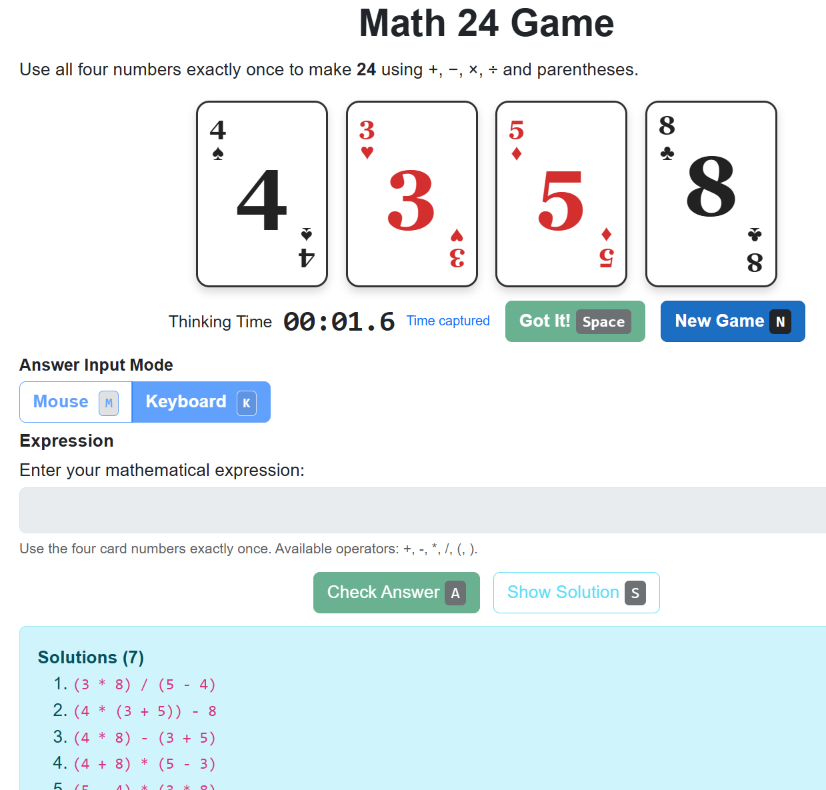
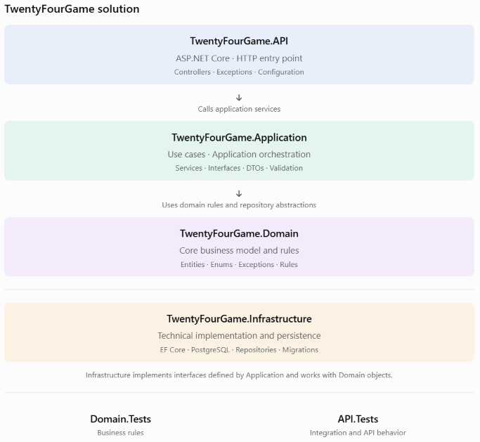

# 24 Game — .NET Full-Stack Implementation

An independent full-stack implementation of the 24 Game using .NET 10, Blazor Interactive Server, ASP.NET Core Web API, Entity Framework Core, and PostgreSQL. Players use four numbers exactly once with arithmetic operations and parentheses to make 24.

The frontend and backend are separate applications communicating through HTTPS REST APIs. This implementation is maintained independently of the React and Node.js versions in the same repository.

**[Play the live .NET game](https://twentyfourgame-web-adc8daghhthxb8ab.canadaeast-01.azurewebsites.net/)**

## Screenshots

### .NET Full-Stack Version (Blazor + ASP.NET Core)



### Backend Solution Architecture



## Game Features

- Automatically generate solvable four-number puzzles.
- Build and check arithmetic expressions using mouse or keyboard input.
- Use **Got It** to capture thinking time before entering an answer.
- Reveal solutions and start another puzzle.
- Resume a session and review saved games, history, and statistics.

## Technology Stack

- **Frontend:** Blazor Web App with Interactive Server rendering, C# / Razor
- **Backend:** C# / ASP.NET Core Web API 10
- **Framework:** .NET 10
- **Database:** PostgreSQL
- **ORM:** Entity Framework Core 10
- **PostgreSQL provider:** Npgsql
- **API documentation:** ASP.NET Core OpenAPI
- **Testing:** xUnit
- **API testing:** Postman
- **Hosting:** Azure App Service (Linux, .NET 10) for frontend and API
- **Production database:** Neon PostgreSQL
- **CI/CD:** GitHub Actions with Microsoft Entra ID OIDC authentication

## Architecture

The frontend runs as a Blazor Interactive Server application and calls the backend through a named `HttpClient`. The backend follows a layered architecture separating API, application logic, domain rules, and infrastructure.

```text
Browser
  | HTTPS / Blazor SignalR
  v
Blazor frontend (Azure App Service: twentyfourgame-web)
  | HTTPS REST API
  v
ASP.NET Core API (Azure App Service: twentyfourgame-api)
  | EF Core / Npgsql
  v
Neon PostgreSQL
```

### Repository layout

```text
dotnet-fullstack/
├── blazor-frontend/        # Blazor Interactive Server UI and API client
├── backend/                # Layered ASP.NET Core API and tests
└── README.md
```

### Backend layout

```text
backend/
├── src/
│   ├── TwentyFourGame.API/
│   │   ├── Controllers/
│   │   ├── Exceptions/
│   │   └── Properties/
│   │
│   ├── TwentyFourGame.Application/
│   │   ├── DependencyInjection/
│   │   ├── DTOs/
│   │   ├── Interfaces/
│   │   ├── Services/
│   │   └── Validation/
│   │
│   ├── TwentyFourGame.Domain/
│   │   ├── Entities/
│   │   ├── Enums/
│   │   ├── Exceptions/
│   │   └── Rules/
│   │
│   └── TwentyFourGame.Infrastructure/
│       ├── DependencyInjection/
│       └── Persistence/
│           └── Migrations/
│
└── tests/
    ├── TwentyFourGame.API.Tests/
    │   ├── Controllers/
    │   ├── Factories/
    │   └── Persistence/
    │
    └── TwentyFourGame.Domain.Tests/
```

### Layer responsibilities

| Layer | Responsibility |
|---|---|
| API | HTTP endpoints, controllers, exception handling, and API configuration |
| Application | Application services, DTOs, interfaces, and validation |
| Domain | Game entities, domain rules, enums, and domain exceptions |
| Infrastructure | PostgreSQL persistence, EF Core, repositories, and migrations |

The API layer depends on the Application and Infrastructure layers. Application depends on Domain. Infrastructure implements persistence and repository interfaces defined by the Application layer.

## Local Development

The frontend and API run as separate processes. The frontend reads the backend URL from `BackendApi:BaseUrl`; the API reads its database connection from `ConnectionStrings:DefaultConnection`.

## Prerequisites

- .NET 10 SDK
- PostgreSQL
- Visual Studio 2022 or later, or Visual Studio Code
- EF Core CLI (`dotnet-ef`)
- Postman (optional, for manual API testing)

## Getting Started

### 1. Clone the repository

```powershell
git clone https://github.com/RichardWu2168/24-game.git
cd 24-game/dotnet-fullstack/backend
```

### 2. Create the PostgreSQL database

Create a local PostgreSQL database for the application.

For example, using `createdb`:

```powershell
createdb twentyfourgame_dotnet
```

You can also create the database through pgAdmin.

### 3. Configure the database connection

The API reads its PostgreSQL connection string from the configuration key:

`ConnectionStrings:DefaultConnection`

Use .NET User Secrets to store the connection string locally:

```powershell
dotnet user-secrets set "ConnectionStrings:DefaultConnection" "Host=localhost;Port=5432;Database=twentyfourgame_dotnet;Username=postgres;Password=YOUR_PASSWORD" --project .\src\TwentyFourGame.API
```

Replace the example username and password with your local PostgreSQL credentials.

The connection string is not stored in the source code or committed to Git.

### 4. Install the EF Core CLI

If you do not already have the EF Core command-line tool installed:

```powershell
dotnet tool install --global dotnet-ef
```

If it is already installed, check its version:

```powershell
dotnet ef --version
```

### 5. Apply database migrations

From the `backend` directory, run:

```powershell
dotnet ef database update --project .\src\TwentyFourGame.Infrastructure --startup-project .\src\TwentyFourGame.API
```

This applies the existing EF Core migrations to the configured PostgreSQL database.

The API does not automatically apply migrations when it starts.

### 6. Run the API

```powershell
dotnet run --project .\src\TwentyFourGame.API
```

The local launch profiles use these URLs:

| Profile | URL |
|---|---|
| HTTP | http://localhost:5216 |
| HTTPS | https://localhost:7112 |

The API exposes its OpenAPI document in the Development environment:

- http://localhost:5216/openapi/v1.json
- https://localhost:7112/openapi/v1.json

### 7. Run the Blazor frontend

Open a **second PowerShell terminal** from the repository root and run:

```powershell
cd .\dotnet-fullstack\blazor-frontend
dotnet run
```

The frontend's `appsettings.json` uses `BackendApi:BaseUrl` with the local HTTPS API address `https://localhost:7112`. Keep the API running in the first terminal. Open the frontend URL printed by `dotnet run`.

For local HTTPS, ensure the ASP.NET Core development certificate is trusted if prompted. Do not put database passwords in the frontend configuration.

## API Endpoints

All endpoints are relative to the API base URL.

| Method | Endpoint | Description |
|---|---|---|
| POST | `/api/gamesessions` | Create a game session |
| GET | `/api/gamesessions/{sessionId}/puzzle` | Get or resume the active puzzle |
| POST | `/api/gamesessions/{sessionId}/puzzle` | Create a new puzzle |
| GET | `/api/gamesessions/{sessionId}/games/{gameId}` | Get a saved game |
| POST | `/api/gamesessions/{sessionId}/games/{gameId}/got-it` | Record that the player solved the puzzle |
| POST | `/api/gamesessions/{sessionId}/games/{gameId}/answers` | Submit an answer |
| POST | `/api/answers/check` | Check an expression without saving a game attempt |
| GET | `/api/gamesessions/{sessionId}/history` | Retrieve paginated game history |
| GET | `/api/gamesessions/{sessionId}/stats` | Retrieve session statistics |
| DELETE | `/api/gamesessions/{sessionId}/history` | Clear session history |

### Health endpoints

- `GET /health` — reports whether the API is responding.
- `GET /health/db` — checks whether EF Core can connect to PostgreSQL.

These checks do not replace end-to-end tests of game operations or schema validation.

## Running Tests

The solution contains two test projects:

- `TwentyFourGame.Domain.Tests` — domain rules and business logic.
- `TwentyFourGame.API.Tests` — controller integration tests and repository tests.

The API integration tests use a separate PostgreSQL database named twentyfourgame_dotnet_test. This keeps test data isolated from the development database.

Run the complete test suite from the `backend` directory:

```powershell
dotnet test
```

The README previously recorded **96 passing tests**; run the suite to verify the current count. Ensure the dedicated test database is configured and available before running integration tests.

## Postman Collection

Postman assets are organized under the `postman/` directory:

```text
postman/
├── collections/
├── documents/
├── environments/
├── flows/
├── globals/
├── mocks/
└── specs/
```

Import the collection and the local environment into Postman.

Set the environment variables for the local API URL, session ID, and game ID as needed.

The default local API base URL is:

```text
http://localhost:5216
```

## Production Deployment

The .NET frontend and backend are deployed as **separate Linux .NET 10 Azure App Services**:

| Service | Production address |
|---|---|
| Blazor frontend | [Math 24 Game](https://twentyfourgame-web-adc8daghhthxb8ab.canadaeast-01.azurewebsites.net/) |
| Backend API | [Azure API](https://twentyfourgame-api-gghuafa9bcewg3c0.canadaeast-01.azurewebsites.net/) |
| API health | [Application health](https://twentyfourgame-api-gghuafa9bcewg3c0.canadaeast-01.azurewebsites.net/health) |
| Database health | [Database connectivity](https://twentyfourgame-api-gghuafa9bcewg3c0.canadaeast-01.azurewebsites.net/health/db) |

The backend uses a Neon-hosted PostgreSQL database. EF Core migrations are **not** applied automatically when the API starts or deploys; apply and review schema changes separately before deploying code that depends on them.

### Production configuration

Configure the following **Azure App Service application settings** (do not commit secrets):

| App | Setting | Purpose |
|---|---|---|
| Backend | `ASPNETCORE_ENVIRONMENT=Production` | Production runtime environment |
| Backend | `ConnectionStrings__DefaultConnection` | Neon PostgreSQL connection string; use the pooled host for runtime traffic |
| Frontend | `ASPNETCORE_ENVIRONMENT=Production` | Production runtime environment |
| Frontend | `BackendApi__BaseUrl` | HTTPS base URL of the deployed backend API |

ASP.NET Core maps double underscores (`__`) in environment-variable names to configuration separators (`:`). The Azure frontend setting overrides the localhost URL in `blazor-frontend/appsettings.json`.

Keep database credentials in Azure settings, not in Git or published documentation. The frontend's API calls originate from the Blazor server, rather than directly from browser JavaScript.

### GitHub Actions CI/CD

Workflows live in the repository root at `.github/workflows/`:

- **`backend-ci.yml`** — restores, builds, and publishes the backend; generates a separate EF Core migration SQL artifact; and deploys the API to Azure.
- **`frontend-ci.yml`** — restores, builds, and publishes the Blazor frontend; then deploys it to Azure. Its push trigger filters changes to `dotnet-fullstack/blazor-frontend/**` and the workflow file.

Both workflows support automated deployment from the `main` branch. Deployment jobs authenticate with Azure using **Microsoft Entra ID workload identity federation (OIDC)**, GitHub repository variables (`AZURE_CLIENT_ID`, `AZURE_TENANT_ID`, `AZURE_SUBSCRIPTION_ID`), and scoped Azure role assignments. No long-lived Azure client secret is required.

A successful CI/CD run confirms that the build and deployment steps completed; application health and game behavior should still be checked after release. The backend workflow generates migration SQL but **does not execute it against production automatically**.

### Production verification

The deployed application has been checked for frontend page loading, puzzle generation, Got It timing, answer submission, and new puzzles. The API `/health` and `/health/db` endpoints returned `Healthy`, and a production API smoke test successfully created a game session in Neon.

The apps currently use the Azure App Service **F1 Free** tier, which has limited resources and may experience cold starts or interruptions. Blazor Interactive Server depends on a live server connection.

## Project Status

The .NET full-stack implementation is **deployed and operational**. It includes:

- Blazor Interactive Server UI with mouse and keyboard interaction
- Layered ASP.NET Core API and domain validation
- PostgreSQL persistence using EF Core, repositories, and migrations
- Game sessions, puzzle management, history, and statistics
- Unit and integration tests
- Azure hosting and GitHub Actions CI/CD

## Related Implementations

This repository also contains other independent implementations of the 24 Game:

- React / TypeScript
- React / TypeScript with Node.js, Express, Prisma, and PostgreSQL

The .NET implementation is maintained separately so that the different technology stacks can evolve independently.