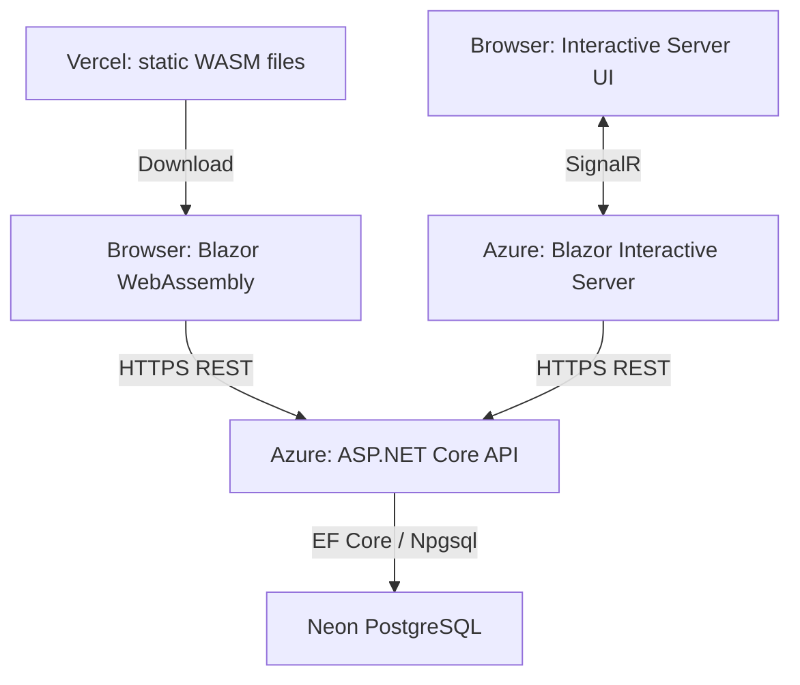

# 24 Game — .NET Full-Stack Implementation

An independent full-stack implementation of the 24 Game using .NET 10, Blazor, ASP.NET Core Web API, Entity Framework Core 10, and PostgreSQL. Players use four numbers exactly once with arithmetic operations and parentheses to make 24.

Two separately deployed frontends use the same Azure-hosted REST API and Neon PostgreSQL database. This implementation is maintained independently of the React and Node.js versions in the same repository.

| Frontend | Hosting | Live game |
|---|---|---|
| Blazor WebAssembly | Vercel | [Play the WebAssembly version](https://blazor-wasm-beige.vercel.app) |
| Blazor Interactive Server | Azure App Service | [Play the Interactive Server version](https://twentyfourgame-web-adc8daghhthxb8ab.canadaeast-01.azurewebsites.net/) |

## Screenshots

### Blazor Interactive Server


### Backend Solution Architecture


## Game Features

- Automatically generate solvable four-number puzzles.
- Build and check arithmetic expressions using mouse or keyboard input.
- Use **Got It** to capture thinking time before entering an answer.
- Reveal solutions and start another puzzle.
- Restore the active session, puzzle, and timing information after a reload.
- Remember the selected mouse or keyboard input mode.
- Persist sessions, games, attempts, and timing through the API; retrieve history and statistics through its endpoints.

### Keyboard shortcuts

Both Blazor frontends use these game shortcuts:

| Action | Shortcut |
|---|---|
| Switch to mouse input | `M` |
| Switch to typed input | `K` |
| Start a new game | `N` |
| Capture thinking time with Got It | `Space` |
| Check answer | `A`, or `Enter` while the expression input is focused |
| Show solutions | `S` |
| Clear the expression | `Delete` |
| Undo a mouse-input step | `Backspace` outside the typed expression input |

Backspace retains normal text editing inside the expression input. Shortcuts ignore repeated keydown events, Ctrl/Alt/Meta combinations, and unrelated editable controls.

### Timer and session restoration

The timer displays minutes, seconds, and tenths (`mm:ss.t`). **Got It** captures thinking time while expression entry remains available. The UI confirms the saved duration returned by the API. A correct answer or solution reveal ends the current puzzle's timer.

The browser stores the session identifier and input-mode preference in `localStorage`; the API supplies the active puzzle and its timing information when a session is restored. Draft expressions and previously displayed answer or solution messages are not persisted.

Browser storage belongs to an origin. The localhost, Vercel, and Azure frontend addresses therefore keep separate saved session identifiers and input preferences, even though they use the same API. See [MDN's localStorage documentation](https://developer.mozilla.org/en-US/docs/Web/API/Window/localStorage).

## Technology Stack

- **WebAssembly frontend:** Standalone Blazor WebAssembly, C# / Razor, running in the browser
- **Interactive Server frontend:** Blazor Web App with Interactive Server rendering, C# / Razor
- **Backend:** C# / ASP.NET Core Web API 10
- **Framework:** .NET 10
- **Database:** PostgreSQL
- **ORM:** Entity Framework Core 10
- **PostgreSQL provider:** Npgsql
- **API documentation:** ASP.NET Core OpenAPI
- **Testing:** xUnit
- **API testing:** Postman
- **WebAssembly hosting:** Vercel, serving published static files
- **Server hosting:** Azure App Service (Linux, .NET 10) for the Interactive Server frontend and API
- **Production database:** Neon PostgreSQL
- **CI/CD:** GitHub Actions; Microsoft Entra ID OIDC for Azure deployments and a Vercel token for the WebAssembly deployment

## Architecture

The standalone WebAssembly frontend downloads from Vercel and runs in the browser. Its named `HttpClient` calls the Azure API directly, so the API must allow the browser's origin through CORS. The Interactive Server frontend runs on Azure and calls the API from its server process; its browser UI uses a Blazor server connection.



The WebAssembly project reuses copies of the game components, models, frontend services, JavaScript modules, and CSS. Its bootstrap code and static host page are specific to WebAssembly. The projects remain independently deployable; there is currently no shared Razor class library. The backend follows a layered architecture separating API, application logic, domain rules, and infrastructure.

### Repository layout

```text
dotnet-fullstack/
├── blazor-wasm/             # Standalone WebAssembly UI and API client
├── blazor-frontend/         # Interactive Server UI and API client
├── backend/                 # Layered ASP.NET Core API and tests
└── README.md
```

Key WebAssembly files:

| Path within `blazor-wasm/` | Purpose |
|---|---|
| `TwentyFourGame.BlazorWasm.csproj` | Standalone .NET 10 WebAssembly project |
| `Components/Game/` | Game board, timer, cards, expression inputs, and scoped CSS |
| `Services/` | REST API client and browser-storage interop |
| `wwwroot/appsettings.json` | Public backend API base URL |
| `wwwroot/index.html` | Static host page and WebAssembly startup |
| `deployment/vercel/config.json` | Vercel routing configuration used during deployment |

GitHub Actions workflows are stored at the repository root in [`.github/workflows/`](../.github/workflows/).

### Backend layout

```text
backend/
├── src/
│   ├── TwentyFourGame.API/
│   │   ├── Controllers/
│   │   ├── Exceptions/
│   │   └── Properties/
│   │
│   ├── TwentyFourGame.Application/
│   │   ├── DependencyInjection/
│   │   ├── DTOs/
│   │   ├── Interfaces/
│   │   ├── Services/
│   │   └── Validation/
│   │
│   ├── TwentyFourGame.Domain/
│   │   ├── Entities/
│   │   ├── Enums/
│   │   ├── Exceptions/
│   │   └── Rules/
│   │
│   └── TwentyFourGame.Infrastructure/
│       ├── DependencyInjection/
│       └── Persistence/
│           └── Migrations/
│
└── tests/
    ├── TwentyFourGame.API.Tests/
    │   ├── Controllers/
    │   ├── Factories/
    │   └── Persistence/
    │
    └── TwentyFourGame.Domain.Tests/
```

### Layer responsibilities

| Layer | Responsibility |
|---|---|
| API | HTTP endpoints, controllers, exception handling, and API configuration |
| Application | Application services, DTOs, interfaces, and validation |
| Domain | Game entities, domain rules, enums, and domain exceptions |
| Infrastructure | PostgreSQL persistence, EF Core, repositories, and migrations |

The API layer depends on the Application and Infrastructure layers. Application depends on Domain. Infrastructure implements persistence and repository interfaces defined by the Application layer.

## Local Development

For the quickest frontend setup, run WebAssembly locally against the hosted Azure API. A local database is only needed when running the API locally. Both frontends use `BackendApi:BaseUrl`; the API reads its database connection from `ConnectionStrings:DefaultConnection`.

## Prerequisites

- .NET 10 SDK
- An editor or IDE with .NET 10 support
- PostgreSQL and EF Core CLI 10 (`dotnet-ef`) when running the backend locally
- Node.js 24 and npm when using the Vercel CLI for a manual deployment
- Postman (optional, for manual API testing)

## Getting Started

### Run WebAssembly against the hosted API

From a new PowerShell terminal:

```powershell
git clone https://github.com/RichardWu2168/24-game.git
cd .\24-game\dotnet-fullstack

dotnet run --project .\blazor-wasm\TwentyFourGame.BlazorWasm.csproj --launch-profile http
```

If the repository is already cloned, start from your existing `dotnet-fullstack` directory and run only the `dotnet run` command.

Open [http://localhost:5046](http://localhost:5046). The checked-in `blazor-wasm/wwwroot/appsettings.json` points to:

```json
{
  "BackendApi": {
    "BaseUrl": "https://twentyfourgame-api-gghuafa9bcewg3c0.canadaeast-01.azurewebsites.net/"
  }
}
```

This option uses the production API and its database for game data. The Azure API currently allows the `http://localhost:5046` browser origin. For development using a separate database, follow the local backend setup below.

## Local Backend Setup

### 1. Clone the repository

```powershell
git clone https://github.com/RichardWu2168/24-game.git
cd 24-game/dotnet-fullstack/backend
```

For an existing clone, navigate directly to `dotnet-fullstack/backend`.

### 2. Create the PostgreSQL database

Create a local PostgreSQL database for the application.

For example, using `createdb`:

```powershell
createdb twentyfourgame_dotnet
```

You can also create the database through pgAdmin.

### 3. Configure the database connection

The API reads its PostgreSQL connection string from the configuration key:

`ConnectionStrings:DefaultConnection`

Use .NET User Secrets to store the connection string locally:

```powershell
dotnet user-secrets set "ConnectionStrings:DefaultConnection" "Host=localhost;Port=5432;Database=twentyfourgame_dotnet;Username=postgres;Password=YOUR_PASSWORD" --project .\src\TwentyFourGame.API
```

Replace the example username and password with your local PostgreSQL credentials.

The connection string is not stored in the source code or committed to Git.

### 4. Install the EF Core CLI

If you do not already have the EF Core command-line tool installed:

```powershell
dotnet tool install --global dotnet-ef --version '10.0.*'
```

If it is already installed, check its version:

```powershell
dotnet ef --version
```

Keep the CLI on the EF Core 10 release series used by the backend. See [Installing Entity Framework Core](https://learn.microsoft.com/en-us/ef/core/get-started/overview/install).

### 5. Apply database migrations

From the `backend` directory, run:

```powershell
dotnet ef database update --project .\src\TwentyFourGame.Infrastructure --startup-project .\src\TwentyFourGame.API
```

This applies the existing EF Core migrations to the configured PostgreSQL database.

The API does not automatically apply migrations when it starts.

### 6. Run the API

For local HTTPS, trust the ASP.NET Core development certificate if necessary before starting the API:

```powershell
dotnet dev-certs https --trust
```

When a local WebAssembly frontend will call this API, configure its browser origin in the same PowerShell terminal:

```powershell
$env:Cors__AllowedOrigins__0 = 'http://localhost:5046'

dotnet run --project .\src\TwentyFourGame.API -- --urls 'https://localhost:7112;http://localhost:5216'
```

This command starts the API at the addresses used by the local launch profiles:

| Profile | URL |
|---|---|
| HTTP | [http://localhost:5216](http://localhost:5216) |
| HTTPS | [https://localhost:7112](https://localhost:7112) |

The API exposes its OpenAPI document in the Development environment:

- [HTTP OpenAPI document](http://localhost:5216/openapi/v1.json)
- [HTTPS OpenAPI document](https://localhost:7112/openapi/v1.json)

### 7. Run a frontend against the local API

#### WebAssembly

Create `blazor-wasm/wwwroot/appsettings.Development.json` with the local API address:

```json
{
  "BackendApi": {
    "BaseUrl": "https://localhost:7112/"
  }
}
```

In a second PowerShell terminal, from `dotnet-fullstack`, run:

```powershell
dotnet run --project .\blazor-wasm\TwentyFourGame.BlazorWasm.csproj --launch-profile http
```

The development configuration overrides the public base configuration during local development. The production deployment continues to use `wwwroot/appsettings.json`. Both files are public client assets, so keep database credentials and tokens out of them. See [Blazor configuration](https://learn.microsoft.com/en-us/aspnet/core/blazor/fundamentals/configuration?view=aspnetcore-10.0).

#### Interactive Server

Open a **second PowerShell terminal** from the repository root and run:

```powershell
cd .\dotnet-fullstack\blazor-frontend
dotnet run
```

The frontend's `appsettings.json` uses `BackendApi:BaseUrl` with the local HTTPS API address `https://localhost:7112`. Keep the API running in the first terminal. Open the frontend URL printed by `dotnet run`.

The server frontend uses its own configuration and service registrations. Its calls to the API originate on the server.

## API Endpoints

All endpoints are relative to the API base URL.

| Method | Endpoint | Description |
|---|---|---|
| POST | `/api/gamesessions` | Create a game session |
| GET | `/api/gamesessions/{sessionId}/puzzle` | Get or resume the active puzzle |
| POST | `/api/gamesessions/{sessionId}/puzzle` | Create a new puzzle |
| GET | `/api/gamesessions/{sessionId}/games/{gameId}` | Get a saved game |
| POST | `/api/gamesessions/{sessionId}/games/{gameId}/got-it` | Record that the player solved the puzzle |
| POST | `/api/gamesessions/{sessionId}/games/{gameId}/answers` | Submit an answer |
| POST | `/api/gamesessions/{sessionId}/games/{gameId}/reveal-solution` | Reveal solutions for the game |
| POST | `/api/answers/check` | Check an expression without saving a game attempt |
| GET | `/api/gamesessions/{sessionId}/history` | Retrieve paginated game history |
| GET | `/api/gamesessions/{sessionId}/stats` | Retrieve session statistics |
| DELETE | `/api/gamesessions/{sessionId}/history` | Clear session history |

### Health endpoints

- `GET /health` — reports whether the API is responding.
- `GET /health/db` — checks whether EF Core can connect to PostgreSQL.

These checks do not replace end-to-end tests of game operations or schema validation.

## Running Tests

The solution contains two test projects:

- `TwentyFourGame.Domain.Tests` — domain rules and business logic.
- `TwentyFourGame.API.Tests` — controller integration tests and repository tests.

The API integration tests use a separate PostgreSQL database named twentyfourgame_dotnet_test. This keeps test data isolated from the development database.

Run the complete test suite from the `backend` directory:

```powershell
dotnet test
```

The README previously recorded **96 passing tests**; run the suite to verify the current count. Ensure the dedicated test database is configured and available before running integration tests.

## Postman Collection

Postman assets are organized under the `postman/` directory:

```text
postman/
├── collections/
├── documents/
├── environments/
├── flows/
├── globals/
├── mocks/
└── specs/
```

Import the collection and the local environment into Postman.

Set the environment variables for the local API URL, session ID, and game ID as needed.

The default local API base URL is:

```text
http://localhost:5216
```

## Production Deployment

The standalone WebAssembly frontend is deployed as static files to the Vercel project **`blazor-wasm`**. The Interactive Server frontend and API run as **separate Linux .NET 10 Azure App Services**.

| Service | Production address |
|---|---|
| Blazor WebAssembly frontend | [Math 24 Game on Vercel](https://blazor-wasm-beige.vercel.app) |
| Blazor Interactive Server frontend | [Math 24 Game on Azure](https://twentyfourgame-web-adc8daghhthxb8ab.canadaeast-01.azurewebsites.net/) |
| Backend API | [Azure API](https://twentyfourgame-api-gghuafa9bcewg3c0.canadaeast-01.azurewebsites.net/) |
| API health | [Application health](https://twentyfourgame-api-gghuafa9bcewg3c0.canadaeast-01.azurewebsites.net/health) |
| Database health | [Database connectivity](https://twentyfourgame-api-gghuafa9bcewg3c0.canadaeast-01.azurewebsites.net/health/db) |

Both frontends use the same API and Neon-hosted PostgreSQL database. EF Core migrations are **not** applied automatically when the API starts or deploys; review and apply schema changes separately before deploying code that depends on them.

### Azure runtime configuration

Configure the following **Azure App Service application settings** (do not commit secrets):

| App | Setting | Purpose |
|---|---|---|
| Backend | `ASPNETCORE_ENVIRONMENT=Production` | Production runtime environment |
| Backend | `ConnectionStrings__DefaultConnection` | Neon PostgreSQL connection string; use the pooled host for runtime traffic |
| Interactive Server frontend | `ASPNETCORE_ENVIRONMENT=Production` | Production runtime environment |
| Interactive Server frontend | `BackendApi__BaseUrl` | HTTPS base URL of the deployed backend API |

ASP.NET Core maps double underscores (`__`) in environment-variable names to configuration separators (`:`). The Azure frontend setting overrides the localhost URL in `blazor-frontend/appsettings.json`.

Keep database credentials in the API's server-side configuration. The Interactive Server frontend calls the API from its Azure process. WebAssembly calls the API from the visitor's browser.

### WebAssembly configuration and CORS

The WebAssembly API URL is published in `blazor-wasm/wwwroot/appsettings.json`, as shown in the quick start. Visitors can download that configuration file. It contains the public API URL; database connection strings and deployment tokens belong in server settings or GitHub Actions secrets.

Changing a Vercel environment variable alone does not rewrite this already published JSON file. To change the API URL, update the client configuration used during publication and redeploy the static output.

The effective production CORS configuration is the **Allowed Origins** list on the API's Azure App Service, `twentyfourgame-api`:

| Allowed origin | Purpose |
|---|---|
| `http://localhost:5046` | Local WebAssembly development and published-output checks |
| `https://blazor-wasm-beige.vercel.app` | Production WebAssembly frontend |

Origins must match the browser's scheme, hostname, and port, with no path or trailing slash. A different local port, custom domain, or Vercel preview URL is a different origin and needs its own allowance if it should call the API.

The API also has an ASP.NET Core CORS policy configured through `Cors:AllowedOrigins`. The existing Azure settings `Cors__AllowedOrigins__0` and `Cors__AllowedOrigins__1` mirror the two origins above. **Azure App Service CORS takes precedence while it is enabled**; the mirrored application settings are not a second requirement for platform CORS to work. For a locally hosted API, use the application policy as described in the local setup. See [App Service CORS versus application CORS](https://learn.microsoft.com/en-us/azure/app-service/app-service-web-tutorial-rest-api#app-service-cors-vs-your-cors).

### GitHub Actions CI/CD

Workflows live in the repository root at [`.github/workflows/`](../.github/workflows/):

| Workflow | Automatic trigger | Deployment |
|---|---|---|
| [Backend CI](../.github/workflows/backend-ci.yml) | Every push to `main` | Build and publish the API, generate a migration SQL artifact, and deploy to Azure |
| [Frontend CI/CD](../.github/workflows/frontend-ci.yml) | Push to `main` changing `dotnet-fullstack/blazor-frontend/**` or that workflow | Build and publish Interactive Server, then deploy to Azure |
| [Blazor WASM CI/CD](../.github/workflows/blazor-wasm-ci.yml) | Push to `main` changing `dotnet-fullstack/blazor-wasm/**` or that workflow | Publish WebAssembly, prepare static output, and deploy to Vercel |

All three support manual dispatch. The WASM job also checks that its branch is `main`, including manual runs. A documentation-only push to `main` still triggers the backend workflow because it has no path filter.

The two Azure deployment jobs authenticate through **Microsoft Entra ID workload identity federation (OIDC)**, GitHub repository variables (`AZURE_CLIENT_ID`, `AZURE_TENANT_ID`, `AZURE_SUBSCRIPTION_ID`), and scoped Azure role assignments.

The WASM deployment uses these **GitHub repository secrets**:

| Secret | Purpose |
|---|---|
| `VERCEL_TOKEN` | Token with access to the Vercel team that owns the project |
| `VERCEL_ORG_ID` | Owning team identifier |
| `VERCEL_PROJECT_ID` | Identifier of the existing `blazor-wasm` project |

The workflow supplies these values only to the deployment step. The CLI uses the IDs to target the existing project without interactive linking. See [Vercel CLI project selection and authentication](https://vercel.com/docs/cli/global-options).

The WASM workflow runs PowerShell on Ubuntu, selects the .NET 10 SDK, and publishes the project in Release mode. It copies the published `wwwroot` contents into `.vercel/output/static` and copies `deployment/vercel/config.json` to `.vercel/output/config.json`. It checks the required static assets before invoking `vercel deploy --prebuilt --prod --yes`. Production runs use a concurrency group that lets an active deployment finish.

A successful run confirms that its build and deployment steps completed. The current workflows do not run the backend `dotnet test` suite; run that suite separately as described above. The backend workflow generates migration SQL but **does not execute it against production automatically**.

### Release output and static routing

From `dotnet-fullstack`, publish the WebAssembly project with:

```powershell
dotnet publish .\blazor-wasm\TwentyFourGame.BlazorWasm.csproj --configuration Release
```

The deployable static files are written to:

```text
blazor-wasm/bin/Release/net10.0/publish/wwwroot/
```

Deploy the published files, whose framework references and asset fingerprints have been generated by the SDK. The Vercel routing configuration tries existing files first and falls back to `index.html` for client routes such as `/game`:

```json
{
  "version": 3,
  "routes": [
    { "handle": "filesystem" },
    { "src": "/(.*)", "dest": "/index.html" }
  ]
}
```

The tracked source is `blazor-wasm/deployment/vercel/config.json`. `.vercel/output` is generated during deployment and is ignored by Git, along with local Vercel project-link settings. `bin/` and `obj/` are also ignored. Bootstrap's vendored distribution is tracked through an exception in `blazor-wasm/.gitignore`, so a fresh checkout includes the CSS required by the published page.

See [Blazor WebAssembly deployment](https://learn.microsoft.com/en-us/aspnet/core/blazor/host-and-deploy/webassembly?view=aspnetcore-10.0) and [Vercel's Build Output API](https://vercel.com/docs/build-output-api).

### Optional manual Vercel deployment

GitHub Actions is the normal production deployment path. A maintainer can also reproduce the prebuilt deployment from PowerShell. From `dotnet-fullstack`, authenticate and link the project if this checkout is not already linked:

```powershell
npx.cmd --yes vercel@latest login
npx.cmd --yes vercel@latest link --cwd .\blazor-wasm
```

Select the existing `blazor-wasm` project under its owning team. Package and deploy it with:

```powershell
& {
    $ErrorActionPreference = 'Stop'

    dotnet publish .\blazor-wasm\TwentyFourGame.BlazorWasm.csproj --configuration Release
    if ($LASTEXITCODE -ne 0) {
        throw 'WebAssembly publish failed.'
    }

    $publishRoot = '.\blazor-wasm\bin\Release\net10.0\publish\wwwroot'
    $outputRoot = '.\blazor-wasm\.vercel\output'
    $staticRoot = Join-Path $outputRoot 'static'

    if (-not (Test-Path -LiteralPath (Join-Path $publishRoot 'index.html') -PathType Leaf)) {
        throw 'The published index.html is missing.'
    }

    if (Test-Path -LiteralPath $outputRoot) {
        Remove-Item -LiteralPath $outputRoot -Recurse -Force
    }

    New-Item -ItemType Directory -Path $staticRoot -Force | Out-Null

    Get-ChildItem -LiteralPath $publishRoot -Force |
        Copy-Item -Destination $staticRoot -Recurse -Force

    Copy-Item -LiteralPath '.\blazor-wasm\deployment\vercel\config.json' `
        -Destination (Join-Path $outputRoot 'config.json')

    npx.cmd --yes vercel@latest deploy --prebuilt --prod --cwd .\blazor-wasm
    if ($LASTEXITCODE -ne 0) {
        throw 'Vercel deployment failed.'
    }
}
```

Only `.vercel/output` is refreshed by this packaging step; the local `.vercel/project.json` link is preserved.

### Production verification

Earlier Azure production checks covered frontend page loading, puzzle generation, Got It timing, answer submission, and new puzzles. The API `/health` and `/health/db` endpoints returned `Healthy`, and a production API smoke test created a game session in Neon.

For WebAssembly, local development checks passed for input modes, keyboard shortcuts, timer behavior, Got It, answers, solutions, and session restoration. Checks of the locally served published files also passed for startup and styling, direct `/game` loading and refresh, and the New Game, Got It, and solution actions. The Vercel site loaded and its API requests worked after configuring CORS. The first **Blazor WASM CI/CD** production deployment also succeeded.

After a release, check the deployed `/game` route directly, refresh it, and exercise a new puzzle and Got It. Deployment success alone does not establish that every game interaction has passed a production regression test.

The two Azure App Services currently use the **F1 Free** tier, with limited resources and possible cold starts or interruptions. Interactive Server depends on a live server connection. WebAssembly runs its UI in the browser but still depends on the Azure API for game operations and persistence.

## Project Status

The .NET full-stack implementation is **deployed and operational**. It includes:

- Blazor WebAssembly on Vercel and Blazor Interactive Server on Azure, both with mouse and keyboard interaction
- Layered ASP.NET Core API and domain validation
- PostgreSQL persistence using EF Core, repositories, and migrations
- Session restoration and puzzle management, plus history and statistics API endpoints
- Unit and integration tests
- Separate GitHub Actions deployment workflows for the API and both frontends

## Related Implementations

This repository also contains other independent implementations of the 24 Game:

- React / TypeScript
- React / TypeScript with Node.js, Express, Prisma, and PostgreSQL

The .NET implementation is maintained separately so that the different technology stacks can evolve independently.
